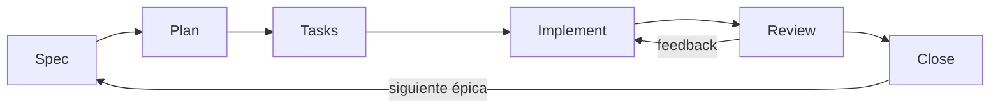

# Guía de la metodología

Lee solo la sección de la fase en la que está la épica actual (ver `docs/ROADMAP.md`). Cada fase termina con la aprobación del PM y deja escrito el contexto suficiente para que la siguiente continúe sin adivinar.

| Fase | Salida | Condición de salida |
| --- | --- | --- |
| Spec | `specs/EPICX/EPICX.md`: problema, no-objetivos, US + criterios de aceptación | El PM está de acuerdo y cada US cumple la Definition of Ready |
| Plan | `specs/EPICX/PLAN.md`: orden de las US, dependencias, decisiones | El PM aprueba, plan `closed` |
| Tasks | `specs/EPICX/TASKS.md`: tareas por US, trazadas a los AC | El PM aprueba, tareas `closed` |
| Implement | código + tests, tareas `[<]` | Todas las tareas implementadas y el PM permite la revisión |
| Review | `specs/EPICX/REVIEW.md`, tareas `[x]` | El PM aprueba cada US |
| Close | `specs/CAPABILITIES.md`, `docs/CHANGELOG.md`, retro | El PM confirma, épica `done` |

---

## Spec

1. Comprueba si existe `specs/EPICX/EPICX.md`.
   - Existe pero está incompleto: informa de su estado y pregunta al PM si quiere ayuda para terminarlo.
   - No existe: crea la carpeta a partir de las plantillas de `EPIC0` y define la épica con el PM.
2. Aclara con `grill-me` (siempre instalada). Haz una pregunta cada vez y ofrece tu respuesta recomendada. Para cuando la épica se pueda escribir sin adivinar, o cuando el PM pida cerrar la spec.
3. Escribe en `EPICX.md`: problema, objetivo, no-objetivos, historias de usuario (`Como X, quiero Y, para Z`) y, para cada US, sus criterios de aceptación (`ACn.m`, Dado/Cuando/Entonces). Reescribe lo que diga el PM en ese formato cuando sea seguro; si no lo es, di qué falta.
4. Anota el resultado de la aclaración en `Acuerdo` (decisiones, riesgos, preguntas abiertas). Es contra lo que los revisores comprobarán el trabajo después.
5. Comprueba cada US contra la Definition of Ready de `AGENTS.md`. Opcional: `/sdd-review spec EPICX` para una comprobación independiente de que la spec se puede implementar sin conocimiento no escrito.
6. Cuando el PM esté de acuerdo, marca la épica como `plan` en `docs/ROADMAP.md`.

## Plan

1. Comprueba `specs/EPICX/PLAN.md` y su estado.
   - No existe: pregunta al PM si quiere un borrador.
   - `WIP`: informa de su estado y pregunta el siguiente paso.
2. Propón el orden de las historias de usuario por valor y dependencias. Quédate a nivel de historia; todavía no dividas en tareas. Anota cualquier decisión de entrega (enfoque técnico, spikes, riesgos). Usa `grill-me` solo si el plan aún necesita aclararse.
3. Pide la aprobación. Una vez aprobado, anota en `PLAN.md` el orden, las dependencias, las decisiones, las preguntas abiertas y la aprobación del PM, márcalo `closed` y marca la épica como `tasks` en `docs/ROADMAP.md`.

## Tasks

1. Comprueba `specs/EPICX/TASKS.md` y su estado (mismas reglas que en Plan).
2. Divide cada US aprobada en tareas pequeñas y accionables. Cada tarea pertenece a una sola US e indica los criterios de aceptación que cubre: `(AC n.m)`. Cada AC debe estar cubierto por al menos una tarea. No inventes alcance; si una US no se puede dividir con claridad, di al PM qué falta.
3. Opcional: `zoom-out` antes de cerrar, para comprobar la coherencia con la arquitectura y el código existente.
4. Presenta el desglose, consigue la aprobación, anótala, márcalo `closed` y marca la épica como `implement` en `docs/ROADMAP.md`.

## Implement

Una tarea pendiente no es un permiso para ejecutarla; solo es la siguiente en orden. Una tarea implementada (`[<]`, `[>]`) no es una tarea hecha.

1. Coge la siguiente tarea de `TASKS.md`:
   - `[-]`: revisa los ficheros afectados y ve al paso 2.
   - `[ ]`: ve al paso 2.
   - `[!]`: ve a **Tareas bloqueadas**.
   - Todas implementadas: pide permiso al PM para pasar a `review`. Si lo da, marca la épica como `review` en `docs/ROADMAP.md`.
2. Márcala `[-]` y propón un plan corto (ficheros, enfoque, tests). Todavía no lo ejecutes. Si depende de decisiones de producto, alcance o stack que faltan, haz preguntas concretas. Cuando el PM esté de acuerdo, ve al paso 3.
3. Implementa siguiendo la Definition of Done de `AGENTS.md`:
   - El cambio útil más pequeño. Usa `tdd` si está instalada (`auto`: siempre para comportamiento nuevo; `manual`: con `/tdd`).
   - Ejecuta el comando de tests documentado en `docs/ARCHITECTURE.md`. Corrige los fallos antes de seguir (skill `debugging` para buscar la causa raíz).
   - Pide permiso al PM para marcarla `[<]`, sugiere un mensaje de commit (`[EPICX][Tn] <resumen>`) y vuelve al paso 1.

### Modo autonomía

El PM puede dar autonomía para una US entera ("autonomía para la US2"). Anótalo junto al título de la US en `TASKS.md` como `(autonomía: sí)`. Entonces planifica e implementa sus tareas sin preguntar en los pasos 2 y 3, marcando igualmente cada una `[<]`. Para y pregunta ante cualquier bloqueo, duda de alcance o test que falle y no sepas arreglar. La puerta de revisión sigue aplicando.

### Tareas bloqueadas

1. Marca la tarea `[!]` y busca tareas abiertas de esta épica que la desbloqueen. Si existen, súbelas justo encima y enuméralas: `[!] [T2] [Blocked by T0, T1]`. Informa al PM y espera.
2. Si no existen, informa del problema y propón tareas que la desbloqueen. Si el PM está de acuerdo, créalas como `[ ]`, colócalas encima, enuméralas como bloqueantes y espera instrucciones.
3. Cuando todas las bloqueantes estén implementadas, quita la lista. Si sigue bloqueada, repite; si no, márcala `[ ]` e impleméntala.

## Review

La revisión se hace por historia de usuario, en el orden de `PLAN.md`.

1. Coge la siguiente US que aún tenga tareas sin marcar `[x]`. Si no queda ninguna, ve a **Close**.
2. Si la US tiene tareas aún sin implementar, impleméntalas primero (Implement, paso 3).
3. Marca todas sus tareas `[>]`.
4. **Puerta de revisión independiente** (si la skill `review` está instalada: automática en modo `auto`, con `/sdd-review` en modo `manual`). Delega en el subagente `sdd-reviewer` pasándole solo rutas de ficheros: el fichero de la épica, `TASKS.md`, `docs/ARCHITECTURE.md` y la lista de ficheros cambiados para esta US. Escribe su veredicto en `specs/EPICX/REVIEW.md`.
   - `CHANGES_REQUESTED` / `REJECTED`: corrige los hallazgos bloqueantes que estén dentro del alcance de la US y vuelve a lanzarla (máximo 3 rondas; después, escala al PM).
   - `NOT_VERIFIED`: algo no se pudo comprobar (por ejemplo, los tests no se pudieron ejecutar). No es una aprobación; di al PM qué falta.
   - Hallazgos menores: enuméralos al PM con tres opciones: corregir ahora, aplazar (añadirlo al backlog de `docs/ROADMAP.md`) o ignorar.
5. Pide al PM que revise la US, mostrando los criterios de aceptación, cómo se verificó cada uno y el veredicto del revisor.
   - OK: marca todas sus tareas `[x]` y vuelve al paso 1.
   - No OK: clasifica el feedback (ver `Clasificación de cambios` en `AGENTS.md`), propón un plan y ofrece: a) implementarlo ahora, b) convertirlo en tareas nuevas de esta US (`[ ]`, tras su última tarea), c) abordarlo en un sprint futuro (marca la US `[x]` y añade el punto al backlog).

## Close

1. Todas las US están `[x]`: pide al PM la confirmación final de la épica.
2. **Reconcilia la documentación** (la documentación es la fuente de verdad, así que debe describir lo que de verdad se construyó):
   - `specs/CAPABILITIES.md`: añade o actualiza las capacidades que esta épica creó o cambió, enlazando a las US y AC que las definen.
   - `docs/ARCHITECTURE.md`: actualízalo si la implementación introdujo una decisión estructural.
   - `docs/CHANGELOG.md`: añade una entrada con fecha para la épica.
3. **Retro**: escribe tres puntos breves al final de `EPICX.md` (mantener, cambiar, acción). Si una acción es una regla para los agentes, propón al PM el cambio en `AGENTS.md`.
4. Marca la épica como `done` con la fecha de hoy en `docs/ROADMAP.md`.
5. Siguiente épica: si existe, márcala `spec` y empieza un sprint nuevo. Si no, pregunta al PM; las épicas nuevas entran en el roadmap como `new`, promovidas desde el backlog cuando toque.
